 

 

## About

I'm a web developer who likes the practical side of software: forms people actually fill in, dashboards people actually read, and small automations that give someone their afternoon back. I graduated in Informatics Engineering in 2024 and have been building for the web ever since.

| | |
| :-- | :-- |
| **Now** | IT Staff at **PT Primajasa Tunas Mandiri**, Jakarta (since Aug 2026) |
| **Before** | Web & App Developer at **Pitucorp** (Dec 2023 – Sep 2025) |
| **Training** | Bangkit Academy 2023 (Cloud Computing) · Kominfo Digital Talent Scholarship 2024 (Data Analytics) |
| **Education** | B.Eng. Informatics Engineering, Universitas Muria Kudus (GPA 3.83) |
| **Focus** | Web applications, internal tools, no-code automation, IT operations |

 

## Tech stack

  

Also: Google AppSheet for no-code apps, and the Google Cloud services I picked up at Bangkit (Compute Engine, Cloud Run, Cloud Functions, BigQuery, Cloud SQL).

 

## Selected work

| Project | What it is | Built with | Links |
| :-- | :-- | :-- | :-- |
| **Jejaknesia** | Mobile app that recommends places to visit in Indonesia. Bangkit capstone, where I built the backend and APIs. | Kotlin · Node.js · TensorFlow · Flask | [Source](https://github.com/Jejaknesia) |
| **Garasi Inspeksi** | Website for a vehicle inspection and maintenance service. | Laravel · MySQL · Bootstrap | [Live](https://garasi-inspeksi-mobil.vercel.app/) · [Source](https://github.com/Alhammanazil/garasi-inspeksi-mobil) |
| **Nawa Kartika** | Graduation announcement system for an elementary school, with secure login. | Laravel · MySQL · Bootstrap | [Live](https://cek-kelulusan-nawakartika.vercel.app/) |
| **Jobless** | Remote job board landing page, sliced from a Figma design. | HTML · CSS | [Live](https://jobless-site.netlify.app/) · [Source](https://github.com/Alhammanazil/Jobless) |
| **Livewire Playground** | Learning project on real-time interfaces with Laravel Livewire. | Laravel · Livewire · Tailwind CSS | [Source](https://github.com/Alhammanazil/learn-livewire) |
| **This portfolio** | Single-page site with an animated hero, experience timeline and a project strip. | Vue 3 · Vite · Tailwind CSS | [Live](https://alham-manazil.netlify.app/) · [Source](https://github.com/Alhammanazil/alham-portfolio) |

More on the [portfolio site](https://alham-manazil.netlify.app/), including what I built at work: an online donation platform, a public event registration system and an internal damage-reporting tool.

 

## Certifications

- Google Cloud Associate Cloud Engineer
- Google IT Support Specialization
- Google Data Analytics Specialization
- Belajar Laravel
- EnglishScore

 

## Get in touch

Always happy to talk about web projects, internal tools and automation. The quickest way to reach me is [LinkedIn](https://www.linkedin.com/in/alham-manazil/) or [email](mailto:alhammanazil18@gmail.com).

  Last updated October 2026

